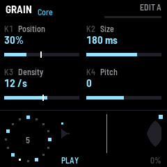

# fm1-txtr manual

fm1-txtr plays itself: press PLAY and the sequencer starts picking notes from the scale. Everything else shapes what
the grains do with them.

## The screen

- **Top:** the page and its sub-page, the patch slot, which snapshot you are editing (A or B), and the morph as a
  thin bar.
- **Middle:** the four parameters on K1 to K4: name, value, and a bar. A white tick on a bar shows where the mod
  matrix has moved the value right now.
- **Bottom:** the Euclidean ring (the current step lit), the grain buffer with its write head and the grains, PLAY or
  STOP, FROZEN, and the audio load.

## Controls

| Control | What it does |
| --- | --- |
| SELECT | Page: SEQ, NOTES, SOUND, GRAIN, SPACE, MOD |
| ALGORITHM | Sub-page of the page |
| K1 to K4 | The four parameters on screen. Hold SEL for fine steps |
| PRESET | Morph from snapshot A to B |
| PLAY | Start or stop the sequencer. Hold half a second: freeze |
| REC | Freeze on or off |
| EDIT | Edit snapshot A or B |
| GLO, held a second | Copy snapshot A into B |
| SEQ, ARP, ENV, FX, LFO | Jump to SEQ, NOTES, SOUND (amp envelope), SPACE, MOD |
| OCT- / OCT+ | The sequencer's octave |
| Keys | Set the root note |
| SEL + keys | Play notes by hand |
| Keys on NOTES, Custom | Add or remove notes from the custom scale |
| SAVE + key 1 to 12 | Save the patch to that slot |
| HOME + key 1 to 12 | Load the patch from that slot |
| MASTER | Volume |

Keys 1 to 12 are the first twelve keys from the left (F3 to E4). The last slot loaded comes back at power-on.

## The pages

| Page | Sub-pages |
| --- | --- |
| SEQ | Rhythm (density, steps, rotate, drift), Clock, Layer 2, Perform (morph) |
| NOTES | Scale, Key, Custom |
| SOUND | Voice, Tone, Pitch env, Amp env, Operator 1 to 6, Op rates, Op levels, Op extras, Filter |
| GRAIN | Core, Scatter, Pitch quant, Window, Direction, Trigger, Buffer, Engine |
| SPACE | Filter, Color, Delay, Delay mod, Reverb, Reverb mod, Feedback, Output |
| MOD | LFO 1 to 3, Random, Follower, Matrix 1 to 8 |

Every parameter is listed with its range in `params/params.py`.

## MIDI

USB-MIDI in plays the FM voice by hand and can clock the sequencer (SEQ, Clock: MIDI). The sequencer's notes go out
over USB. The TRS jack is MIDI in.

## Going back

The installer page has "Back to the stock firmware", which writes M-VAVE's own FM-1 firmware back over the same
cable. If the FM-1 ever fails to start twice in a row it starts in safe mode, from which the installer still works.
